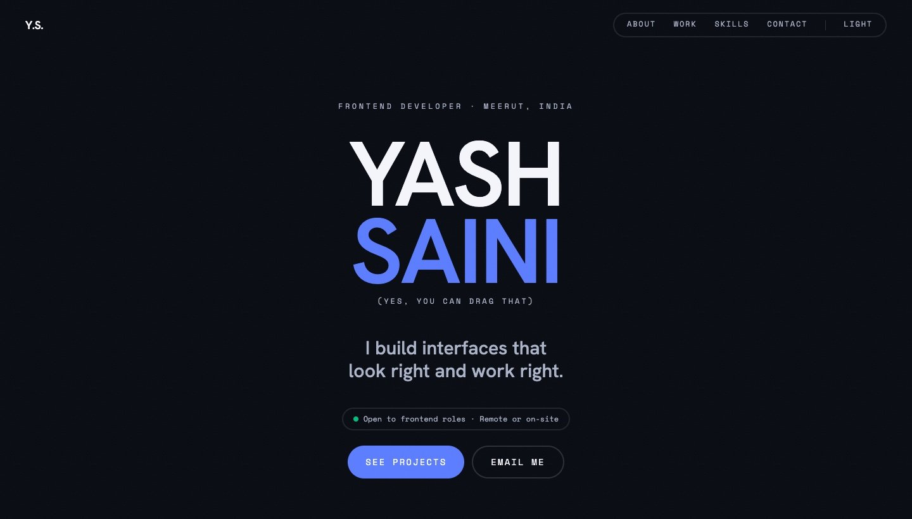

# Yash Saini — Portfolio

Personal site of Yash Saini, a frontend developer who also designs. It covers who I am, the side projects I've built, my skills and how to reach me.



## What's on the page

- **Hero** with a draggable name that stretches with the speed you throw it.
- **Who's typing**: a short intro.
- **How I catch the details**: an interactive music player card with five real UI issues (concentric corners, optical centring, tabular numbers, hover layout shift and text overflow). Each one explains what I spotted, why it happens and what I do about it, with a code diff you can click to apply the fix.
- **Side projects**: cards with mockups, the stack and an expandable "How it's built" list.
- **Skills** and **Contact**.
- Light and dark themes, and reduced-motion support throughout.

## Stack

- Next.js 16 (App Router), React 19, TypeScript
- Tailwind CSS v4, configured in CSS with `@theme`
- `motion` for springs, drag and scroll-triggered animation
- `next/font`: Hanken Grotesk and Space Mono
- `next/og` for the favicon and the link preview image

## Editing content

Text, projects and skills live in `src/app/content.ts`. Project mockups go in `public/projects/`. Site title, description and URL live in `src/app/site.ts`.

## Development

```bash
npm install
npm run dev
```

Set `NEXT_PUBLIC_SITE_URL` to the live address (for example `https://yashsaini.dev`) so link previews and the sitemap use absolute URLs. On Vercel the production URL is picked up automatically.
